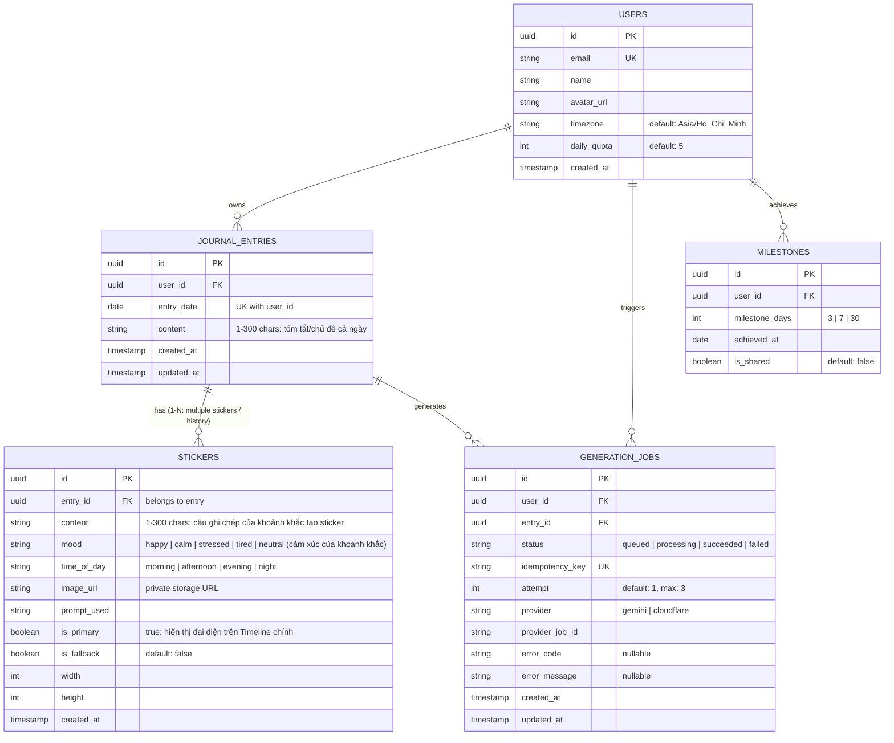

# TÀI LIỆU [A01]: CHỐT PHẠM VI MVP, HỢP ĐỒNG API & DEFINITION OF DONE (DoD)
> **Dự án:** DoodleLife (Doodly) - AI-Powered Visual Journal & Journey Timeline  
> **Người phụ trách:** Bùi Phạm Chí Nhân (Frontend & Product Lead - Luồng A)  
> **Ngày thực hiện:** Ngày 1 - Sprint 1  
> **Phiên bản:** 1.0.0 (Final Draft)  

---

## 1. CHỐT PHẠM VI MVP (PRODUCT SCOPE)

### 1.1. Quy tắc Nghiệp vụ Cốt lõi (Core Business Rules)
* **Giới hạn ghi nhật ký:** Đúng **1 nhật ký / ngày / người dùng** (`unique(user_id, entry_date)`).
* **Độ dài nội dung:** Từ **1 đến 300 ký tự** (sau khi đã tự động `trim()` khoảng trắng thừa đầu/cuối). Không cho phép gửi nội dung rỗng.
* **Múi giờ chuẩn:** Bắt buộc sử dụng múi giờ **`Asia/Ho_Chi_Minh` (UTC+7)** để xác định ranh giới ngày (bắt đầu lúc `00:00:00` và kết thúc lúc `23:59:59`). Nếu người dùng gửi entry, server sẽ tính ngày dựa trên múi giờ này để tránh lệch ngày do múi giờ client.
* **Bố cục hiển thị:** **Timeline dọc (Vertical Journey Timeline)**:
  * Trục thời gian chạy từ trên xuống dưới, sắp xếp theo thứ tự thời gian (`ASC` cho hành trình xuôi hoặc `DESC` cho nhật ký mới nhất).
  * Các sticker doodle được bố trí xen kẽ trái/phải trục đường dẫn uốn lượn.
* **Hệ thống Cột mốc (Milestone Recap):**
  * Tự động kích hoạt khi người dùng đạt mốc tích lũy: **3 ngày, 7 ngày, 30 ngày** tính từ ngày bắt đầu ghi nhật ký đầu tiên.
  * Không bắt buộc streak liên tục (ví dụ: viết ngày 1, ngày 3, ngày 5 vẫn tính là 3 ngày tích lũy).
  * Tổng kết cho phép xem trước và xuất ảnh chia sẻ (Story 9:16).

### 1.2. Ngoài phạm vi MVP (Out-of-scope cho Sprint 1 & 2)
* Chưa hỗ trợ chỉnh sửa sticker bằng tay hoặc xoay kéo thả nâng cao (chuyển sang Sprint sau).
* Chưa tích hợp chat realtime hoặc tính năng mạng xã hội phức tạp nhiều người cùng vẽ.
* Không hỗ trợ upload ảnh cá nhân tùy ý (chỉ dùng sticker do AI tạo hoặc sticker mẫu fallback).

---

## 2. SƠ ĐỒ THỰC THỂ DỮ LIỆU NHÁP (DRAFT ERD)



---

## 3. HỢP ĐỒNG API (API CONTRACT - FRONTEND & BACKEND)

Toàn bộ API được bảo vệ bằng JWT Bearer Token trong header:  
`Authorization: Bearer <access_token>`

Mã phản hồi chuẩn:
* `200 OK` / `201 Created`: Thành công.
* `400 Bad Request`: Sai dữ liệu đầu vào (quá 300 ký tự, sai định dạng date).
* `401 Unauthorized`: Chưa đăng nhập hoặc token hết hạn.
* `403 Forbidden`: Truy cập tài nguyên của user khác.
* `409 Conflict`: Đã có nhật ký trong ngày chỉ định (`DUPLICATE_ENTRY_FOR_DATE`).
* `429 Too Many Requests`: Hết lượt tạo AI trong ngày (`QUOTA_EXCEEDED`).
* `500 / 503`: Lỗi máy chủ / Lỗi bên thứ 3.

---

### 3.1. Phân hệ Nhật ký (Journal Entries)

#### `POST /api/v1/entries`
Tạo mới nhật ký cho một ngày (kèm sticker khoảnh khắc đầu tiên).
* **Headers:** `Idempotency-Key: <uuid>` (chống click lặp)
* **Request Body:**
```json
{
  "entry_date": "2026-11-06",
  "content": "Nay uống cà phê sáng - sảng khoái khởi đầu ngày mới!",
  "mood": "happy", // Cảm xúc của khoảnh khắc tạo sticker này
  "time_of_day": "morning" // "morning" | "afternoon" | "evening" | "night"
}
```
* **Validation & Metadata Enrichment:**
  * `entry_date`: Format `YYYY-MM-DD`, không được vượt quá ngày hiện tại theo giờ `Asia/Ho_Chi_Minh`.
  * `content`: Chuỗi từ 1 đến 300 ký tự. Hệ thống tự động lưu vào `JOURNAL_ENTRIES.content` đồng thời tạo sticker khoảnh khắc đầu tiên với nội dung này.
  * `mood` & `time_of_day`: Được lưu vào bảng `STICKERS`, giúp AI nhận diện cảm xúc và ngữ cảnh thời gian (ví dụ: tươi vui buổi sáng $\rightarrow$ sticker cười rạng rỡ bên tách cà phê).
* **Response `201 Created`:**
```json
{
  "success": true,
  "data": {
    "id": "e4b2d6a1-7788-4e33-9122-892bc0f1103a",
    "entry_date": "2026-11-06",
    "content": "Nay uống cà phê sáng - sảng khoái khởi đầu ngày mới!",
    "created_at": "2026-11-06T08:15:00+07:00",
    "primary_sticker": {
      "id": "stk_01",
      "content": "Nay uống cà phê sáng - sảng khoái khởi đầu ngày mới!",
      "mood": "happy",
      "time_of_day": "morning",
      "status": "queued"
    },
    "job": {
      "id": "job_99a8c1f0",
      "status": "queued",
      "attempt": 1
    }
  }
}
```

---

#### `POST /api/v1/entries/:id/stickers`
Thêm khoảnh khắc / sticker mới vào ngày hiện tại (ví dụ buổi trưa, buổi tối).
* **Headers:** `Idempotency-Key: <uuid>`
* **Request Body:**
```json
{
  "content": "Đạp xe xong rồi - chuẩn bị làm việc năng suất!",
  "time_of_day": "afternoon",
  "mood": "energetic"
}
```
* **Response `201 Created`:**
```json
{
  "success": true,
  "data": {
    "entry_id": "e4b2d6a1-7788-4e33-9122-892bc0f1103a",
    "sticker": {
      "id": "stk_02",
      "content": "Đạp xe xong rồi - chuẩn bị làm việc năng suất!",
      "time_of_day": "afternoon",
      "is_primary": false,
      "created_at": "2026-11-06T12:45:00+07:00"
    },
    "job": {
      "id": "job_11b2e3f4",
      "status": "queued"
    }
  }
}
```
* **Response `409 Conflict`:**
```json
{
  "success": false,
  "error": {
    "code": "DUPLICATE_ENTRY_FOR_DATE",
    "message": "Bạn đã ghi nhật ký cho ngày 2026-11-06 rồi."
  }
}
```

---

#### `GET /api/v1/entries`
Lấy danh sách timeline nhật ký (hỗ trợ phân trang cursor).
* **Query Params:**
  * `cursor`: UUID của entry cuối trang trước (tùy chọn).
  * `limit`: Mặc định `15`, tối đa `50`.
* **Response `200 OK`:**
```json
{
  "success": true,
  "data": {
    "items": [
      {
        "id": "e4b2d6a1-7788-4e33-9122-892bc0f1103a",
        "entry_date": "2026-11-06",
        "content": "Hôm nay hoàn thành xong khung giao diện...",
        "sticker": {
          "id": "stk_01",
          "image_url": "https://storage.doodlelife.app/stickers/stk_01.png?token=exp179397",
          "is_fallback": false
        },
        "job_status": "succeeded"
      }
    ],
    "next_cursor": "e4b2d6a1-7788-4e33-9122-892bc0f1103a",
    "has_more": false
  }
}
```

---

#### `GET /api/v1/entries/:id`
Xem chi tiết một mục nhật ký và danh sách các sticker đã tạo.
* **Response `200 OK`:**
```json
{
  "success": true,
  "data": {
    "id": "e4b2d6a1-7788-4e33-9122-892bc0f1103a",
    "entry_date": "2026-11-06",
    "content": "Hôm nay hoàn thành xong khung giao diện...",
    "created_at": "2026-11-06T19:30:00+07:00",
    "primary_sticker": {
      "id": "stk_01",
      "image_url": "https://storage.doodlelife.app/stickers/stk_01.png?token=exp179397",
      "is_primary": true,
      "prompt": "happy coder, desk with laptop, cute doodle sticker"
    },
    "stickers": [
      {
        "id": "stk_01",
        "content": "Nay uống cà phê sáng - sảng khoái!",
        "mood": "happy",
        "time_of_day": "morning",
        "image_url": "https://storage.doodlelife.app/stickers/stk_01.png?token=exp179397",
        "is_primary": true,
        "created_at": "2026-11-06T08:15:00+07:00"
      },
      {
        "id": "stk_02",
        "content": "Đạp xe xong rồi - chuẩn bị làm việc!",
        "mood": "energetic",
        "time_of_day": "afternoon",
        "image_url": "https://storage.doodlelife.app/stickers/stk_02.png?token=exp179397",
        "is_primary": false,
        "created_at": "2026-11-06T12:45:00+07:00"
      }
    ],
    "job": {
      "id": "job_99a8c1f0",
      "status": "succeeded",
      "error_code": null
    }
  }
}
```

---

#### `DELETE /api/v1/entries/:id`
Xóa một mục nhật ký (và hủy bỏ job/thu hồi quyền truy cập ảnh liên quan).
* **Response `200 OK`:**
```json
{
  "success": true,
  "message": "Xóa mục nhật ký thành công."
}
```

---

### 3.2. Phân hệ Tác vụ Tạo ảnh (AI Generation Jobs)

#### `GET /api/v1/jobs/:id`
Polling trạng thái tiến trình tạo sticker.
* **Response `200 OK`:**
```json
{
  "success": true,
  "data": {
    "id": "job_99a8c1f0",
    "status": "processing", // "queued" | "processing" | "succeeded" | "failed"
    "progress_percent": 60,
    "error_code": null,
    "sticker_url": null
  }
}
```

#### `POST /api/v1/entries/:id/fallback-sticker`
Gán sticker mẫu mặc định khi AI thất bại hoặc người dùng tự chọn.
* **Request Body:**
```json
{
  "fallback_sticker_code": "cute_cat_coffee"
}
```
* **Response `200 OK`:**
```json
{
  "success": true,
  "data": {
    "entry_id": "e4b2d6a1-7788-4e33-9122-892bc0f1103a",
    "sticker_url": "https://assets.doodlelife.app/fallbacks/cute_cat_coffee.png"
  }
}
```

---

### 3.3. Phân hệ Cột mốc (Milestones & Quota)

#### `GET /api/v1/milestones/current`
Kiểm tra mốc đã đạt được và lấy dữ liệu để hiển thị recap.
* **Response `200 OK`:**
```json
{
  "success": true,
  "data": {
    "total_entries": 7,
    "available_milestones": [3, 7],
    "current_milestone": 7,
    "start_date": "2026-10-31",
    "end_date": "2026-11-06",
    "stickers": [
      { "date": "2026-10-31", "sticker_url": "https://..." },
      { "date": "2026-11-06", "sticker_url": "https://..." }
    ]
  }
}
```

#### `GET /api/v1/users/quota`
Lấy hạn mức tạo AI còn lại trong ngày.
* **Response `200 OK`:**
```json
{
  "success": true,
  "data": {
    "daily_limit": 5,
    "remaining_quota": 4,
    "reset_at": "2026-11-07T00:00:00+07:00"
  }
}
```

---

## 4. DEFINITION OF DONE (DoD) CHO TOÀN DỰ ÁN

Mỗi task trong backlog được xem là **HOÀN THÀNH (DONE)** khi thỏa mãn đầy đủ các điều kiện sau:

1. **Về Mã nguồn & Quy trình PR:**
   * Code được đẩy lên nhánh riêng theo quy ước: `feat/<task-code>`, `fix/<task-code>`.
   * Tạo Pull Request có mô tả rõ ràng, đính kèm ảnh chụp màn hình / video test thực tế.
   * Tất cả bài kiểm tra tự động (CI Pipeline: Linting, TypeScript check, Build) đều **PASS xanh**.
   * Có ít nhất **1 thành viên khác trong nhóm review và Approve** trước khi merge.
2. **Về Bảo mật & Quản lý Secret:**
   * Tuyệt đối không commit file chứa credentials, API Key AI, JWT Secret, Database Password lên git.
   * Toàn bộ khóa bí mật của AI model bắt buộc chỉ nằm ở tầng Backend/Server.
3. **Về Tính đúng đắn của Nghiệp vụ:**
   * Đúng theo đặc tả MVP (1 entry/ngày, max 300 chars, timezone Asia/Ho_Chi_Minh).
   * Không để lộ ID tài nguyên hoặc rò rỉ dữ liệu giữa 2 tài khoản khác nhau (Ownership check).
   * Có cơ chế phòng ngừa lỗi mạng, chống submit đúp (Idempotency Key / Disable Button).
